# TaskBoard


TaskBoard is a hotel management platform for medium-sized hotels. It brings the daily work of a hotel into one web application: public room booking, Stripe-backed payment, check-in and check-out, room and floor-plan management, staff scheduling, cleaning assignments, mobile staff workflows, maintenance tickets, minibar tracking, PDF invoices, and management analytics.

The project was built by a six-person team as a software engineering project between October 2025 and January 2026, with roughly 1,200 team hours. It is designed as a full-stack, production-shaped system rather than a small demo: Java 21 and Spring Boot power the backend, Angular 20 drives the frontend, real-time updates use WebSocket/STOMP, and the repository includes CI/CD, container builds, and Kubernetes deployment manifests.

## Screenshots

### Landing Page

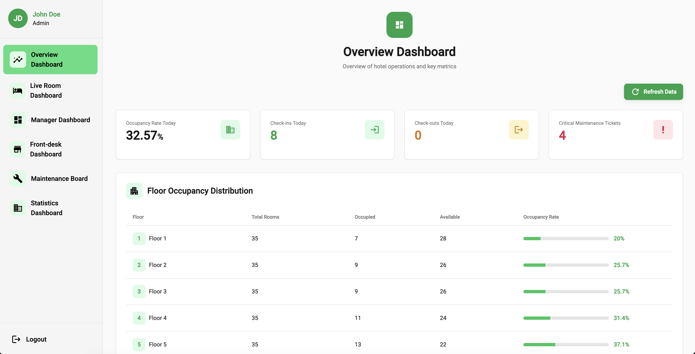

### Guest Booking

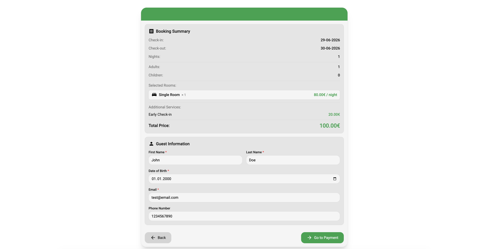

### Administration Dashboard

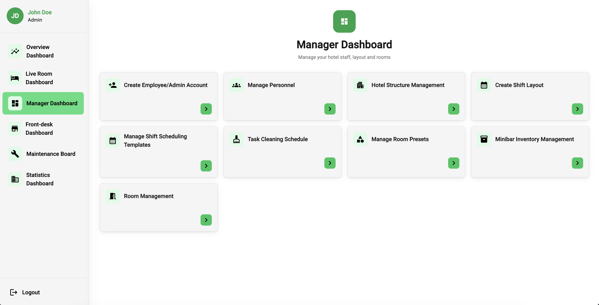

### Floor Plan Editor

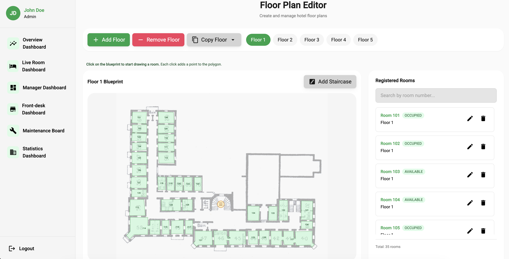

### Mobile Staff View

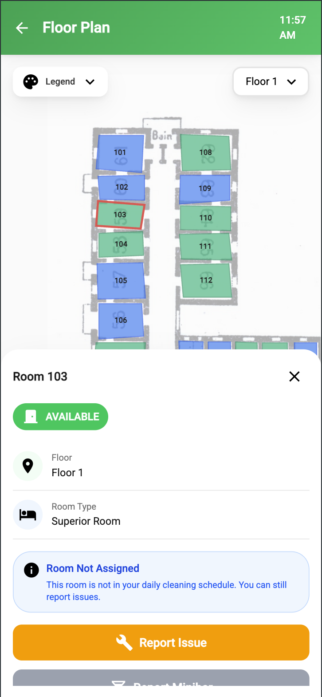

---

## Highlights

- End-to-end guest lifecycle: room search, room recommendation, booking, Stripe checkout, check-in, check-out, invoice generation, and email delivery.
- Real-time operations: live room and maintenance updates via WebSocket, STOMP, and SockJS.
- Scheduling intelligence: greedy and simulated-annealing based engines for shift planning and daily cleaning task assignment.
- Hotel structure tooling: visual floor-plan editor for drawing rooms on top of a hotel blueprint, managing room metadata, and copying floor layouts.
- Staff workflows: role-based dashboards for administrators, front desk employees, and mobile hotel staff.
- Mobile-first staff views: room map, cleaning task list, task progress reporting, minibar reporting, and QR-based mobile authentication.
- Production-oriented delivery: GitLab CI/CD, Kubernetes manifests, health probes, ingress routing, and environment-specific frontend builds.
- Strong backend test coverage: 600+ automated JUnit unit and integration tests across controllers, services, validators, mappers, scheduling, security, and utility logic.

## Feature Tour

### Guest Booking

TaskBoard includes a public booking flow where guests choose dates, enter the number of rooms and guests, review available room options, and complete the reservation. The backend evaluates availability and returns room combinations that satisfy capacity requirements while keeping rooms close together where possible.

The booking module supports:

- date and guest-count based room search
- automatic room recommendations
- multi-room booking support
- Stripe checkout session integration
- payment webhook handling
- booking confirmation emails
- front-desk manual booking creation

### Front Desk Operations

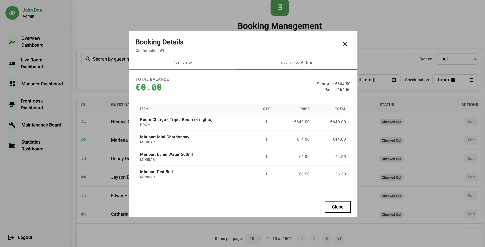

The front desk workflow focuses on the daily rhythm of arrivals and departures. Staff can search bookings, process check-ins, upload guest ID documents, update booking state, check guests out, and trigger invoice generation.

These flows are connected to room status, booking status, invoice data, and the live dashboard event stream, so operational changes are reflected across the system instead of staying isolated in one screen.

### Room and Hotel Structure Management

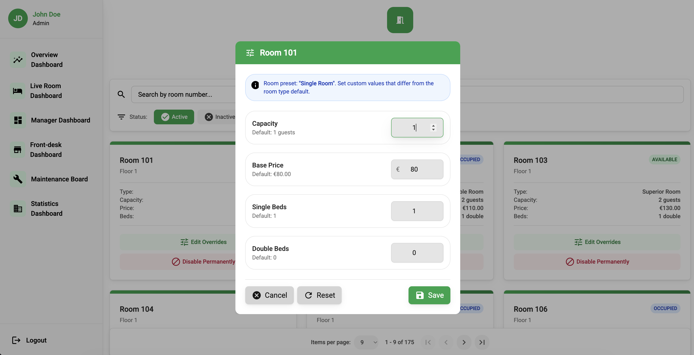

Administrators can model the hotel through room types, rooms, floor plans, and staircases. The visual editor lets users draw room polygons on a blueprint, attach room metadata, copy floor layouts, and maintain the physical room model used by booking, cleaning, and dashboard features.

Room management includes:

- room type presets
- capacity, bed, price, and amenity metadata
- manual per-room overrides
- floor-based room organization
- room enable/disable workflows
- occupancy and floor-occupancy endpoints

### Staff and Shift Scheduling

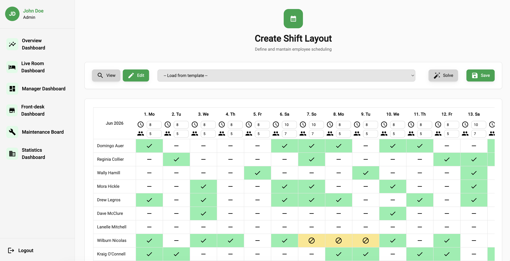

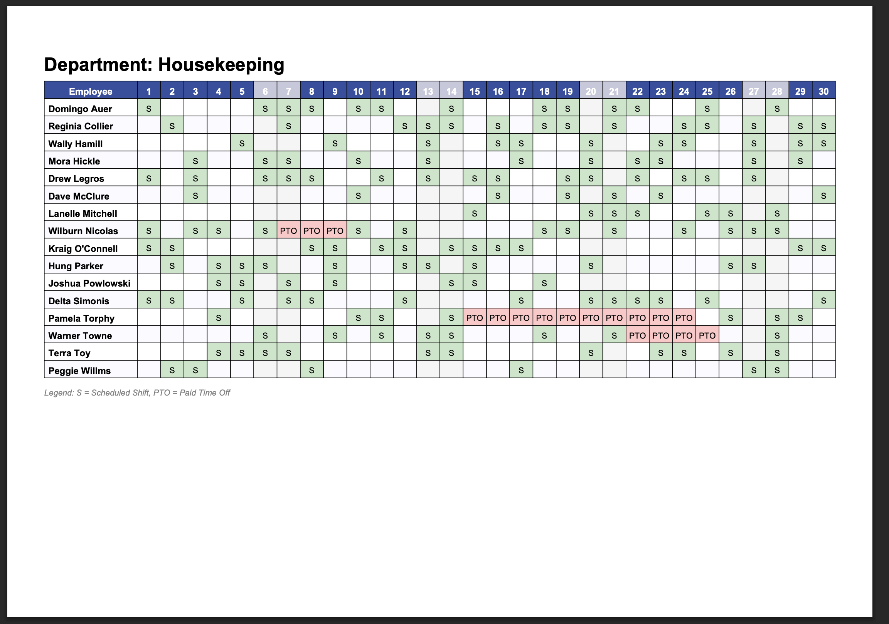

TaskBoard includes workforce planning for hotel staff. Managers can define scheduling roles, create weekly shift layout templates, generate monthly shift schedules, and export schedules as PDFs.

The backend scheduling code includes greedy generators and simulated annealing search. This gives the project a real optimization layer, with cost functions, neighborhoods, generated solutions, and reassignment strategies rather than a purely manual calendar.

### Cleaning Task Scheduling

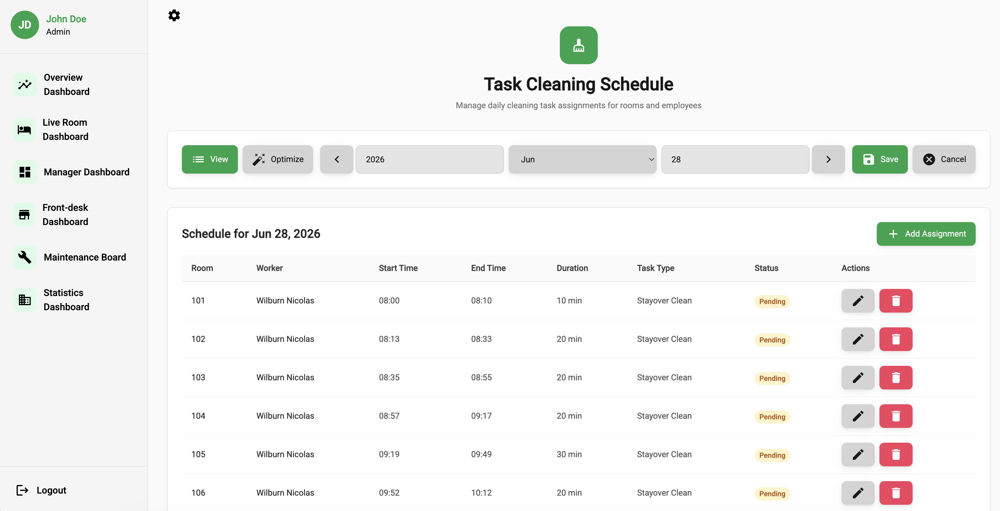

Cleaning is modeled as an operational scheduling problem. The system can generate daily room-cleaning assignments, balance workload across staff, and let employees start, finish, or skip tasks. Task progress updates can feed room state changes and operational dashboards.

The mobile staff experience supports:

- assigned task overview
- room status map
- task start and finish reporting
- do-not-disturb and skipped-room handling
- minibar consumption reporting during room service
- maintenance issue reporting

### Maintenance and Minibar

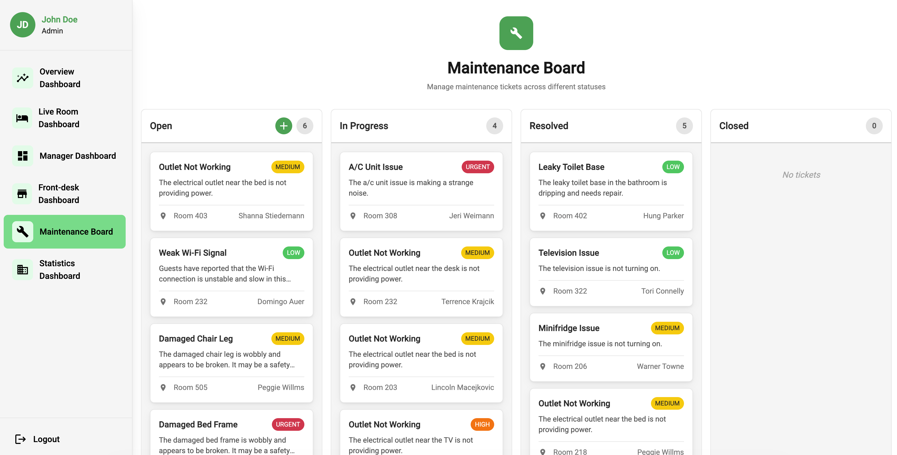

Maintenance tickets are tracked as first-class operational items. Staff can create issues, update status, and keep the board synchronized through real-time update channels.

Minibar features cover inventory items, consumption reporting, restocking, and invoice-relevant charges, linking a small operational workflow back into billing and room service.

### Analytics

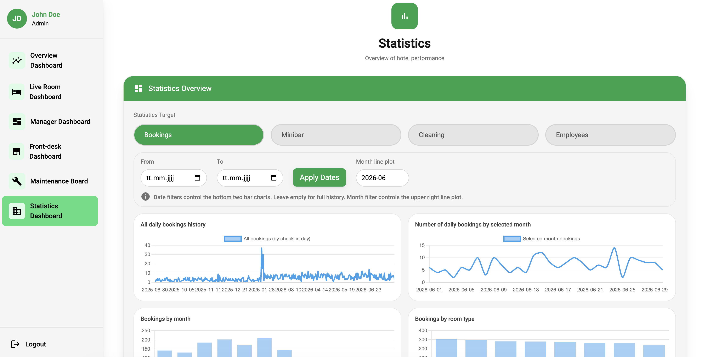

The statistics module aggregates operational data for management dashboards. The backend exposes statistics for bookings, cleaning performance, employees, and minibar activity, while the Angular frontend provides dedicated statistics views with chart support.

## Engineering Highlights

### Real-time Event Pipeline

TaskBoard uses Spring WebSocket support with STOMP messaging and SockJS clients in Angular. The backend publishes events through `SimpMessagingTemplate`, while frontend services subscribe to topics such as:

- `/topic/dashboard-updates`
- `/topic/maintenance-updates`
- `/topic/qr-auth/{sessionId}`

This enables live room-status updates, maintenance board refreshes, and QR-login confirmation without relying on polling-heavy UI flows.

### Optimization Algorithms

The scheduling package includes reusable problem instances, solution types, cost functions, generators, neighborhoods, and simulated annealing search. The system uses this machinery for:

- shift schedule generation
- cleaning task assignment
- workload balancing
- reassignment neighborhoods
- stochastic optimization runs

### Role-based Security

The backend uses Spring Security with JWT authentication and custom role annotations such as `@RequireRole` and `@RequireRoles`. The frontend mirrors this with Angular route guards for admin-only, authenticated, and unauthenticated routes.

Main roles represented in the system:

- administrator
- employee/front desk staff
- mobile staff user flows
- public booking users

### CI/CD and Deployment

The repository includes a GitLab CI/CD pipeline with separate test, verification, build, and deployment stages. The pipeline runs backend tests, backend formatting checks, frontend linting and formatting checks, verifies container builds for merge requests, and builds deployable images for branch deployments.

Deployment artifacts include:

- Spring Boot backend container image built with Jib
- Angular frontend image built with Kaniko and served through nginx
- Kubernetes manifests for local, development, and production deployments
- Kubernetes readiness, liveness, and startup probes
- ingress routing for frontend, REST API, Swagger/OpenAPI, actuator, and WebSocket paths

## Additional Screenshots

|                                     |                                                 |
| ----------------------------------- | ----------------------------------------------- |
| 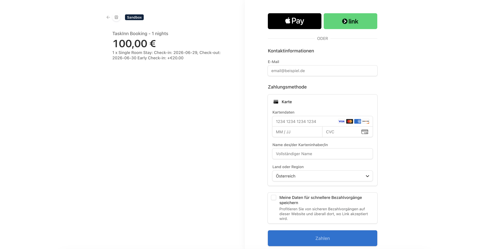 | 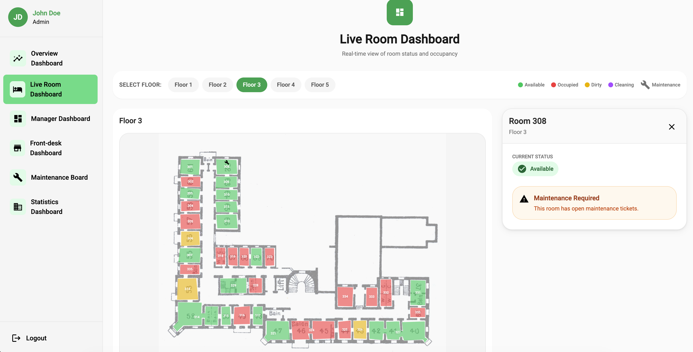 |

## Architecture

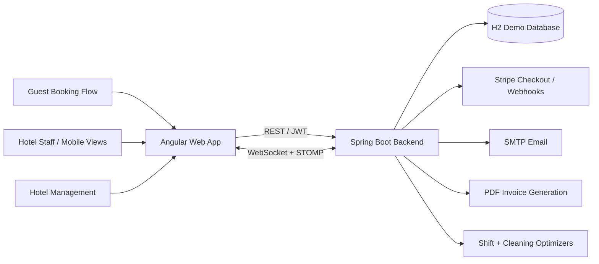

The current project uses a file-based H2 database for development and demo deployments. The persistence layer is Spring Data JPA/Hibernate, so the database can be replaced through Spring datasource configuration for more production-like deployments.

## Tech Stack

| Area         | Technologies                                                               |
| ------------ | -------------------------------------------------------------------------- |
| Frontend     | Angular 20, Angular Material, Tailwind CSS 4, Angular Signals, RxJS        |
| Mobile views | Angular mobile routes, QR authentication, mobile task and room-map screens |
| Backend      | Java 21, Spring Boot 3.5.7, Spring MVC, Spring Security, Spring Data JPA   |
| Real-time    | Spring WebSocket, STOMP, SockJS, `@stomp/stompjs`                          |
| Persistence  | H2 demo database, Hibernate/JPA repositories                               |
| Payments     | Stripe Java SDK, checkout sessions, webhook handling                       |
| Documents    | OpenPDF for invoice PDFs                                                   |
| Email        | Spring Mail, Thymeleaf templates                                           |
| Build        | Maven, npm, Angular CLI                                                    |
| Quality      | JUnit, Spring Boot tests, GreenMail tests, Spotless, ESLint, Prettier      |
| DevOps       | Docker/nginx, Jib, Kaniko, GitLab CI/CD, Kubernetes                        |

## Repository Structure

```text
TaskBoard/
|-- taskinn-backend/              # Spring Boot backend
|   |-- src/main/java/tuwien/taskinn/
|   |   |-- controller/           # REST controllers
|   |   |-- services/             # Business logic and scheduling orchestration
|   |   |-- services/scheduling/  # Greedy and simulated annealing scheduling code
|   |   |-- entity/               # JPA entities
|   |   |-- repo/                 # Spring Data repositories
|   |   |-- security/             # JWT and security configuration
|   |   |-- config/               # WebSocket, OpenAPI, exception handling, logging
|   |   `-- datagenerator/        # Demo data generation
|   `-- src/test/java/            # Unit and integration tests
|-- taskinn-frontend/             # Angular frontend
|   |-- src/app/features/         # Feature areas such as booking, admin, mobile, stats
|   |-- src/app/shared/           # Shared guards, services, components, interceptors
|   `-- public/                   # Static assets
|-- .gitlab-ci.yml                # CI/CD pipeline
`-- local-kube.sh                 # Local minikube deployment helper
```

## Run the Demo Locally

### Prerequisites

| Tool    | Version |
| ------- | ------- |
| Java    | 21      |
| Maven   | 3.9+    |
| Node.js | 22+     |
| npm     | 10+     |

### Backend

```bash
cd taskinn-backend
SPRING_PROFILES_ACTIVE=dev mvn spring-boot:run
```

The backend starts on `http://localhost:8080`.

Useful local URLs:

- Swagger UI: `http://localhost:8080/swagger-ui.html`
- OpenAPI JSON: `http://localhost:8080/api-docs`
- H2 console in dev profile: `http://localhost:8080/h2-console`

The demo data generator creates an initial local admin account:

```text
Email: admin@taskinn.com
Password: password
```

### Frontend

```bash
cd taskinn-frontend
npm install
npm start
```

The Angular app starts on `http://localhost:4200` and calls the backend at `http://localhost:8080/api/v1` in development mode.

## Configuration Notes

The checked-in configuration is suitable for local and demo usage. For a public or production deployment, secrets and provider credentials should be moved out of static YAML files and into environment variables, Kubernetes secrets, or a managed secret store.

Important configuration areas:

- `taskinn-backend/src/main/resources/application.yml`
- `taskinn-backend/src/main/resources/application-dev.yml`
- `taskinn-backend/src/main/resources/application-prod.yml`
- `taskinn-frontend/src/environments/`
- `taskinn-backend/kubernetes-*.yaml`
- `taskinn-frontend/kubernetes-*.yaml`

## Testing

The backend test suite contains more than 600 JUnit test cases across unit and integration tests. Coverage includes authentication, authorization, booking, room management, room types, staff management, maintenance, minibar, mobile auth, invoice generation, statistics, scheduling, validators, mappers, utility classes, and WebSocket-related event behavior.

Manual and system-test scenarios were also designed around the major user journeys: admin login, account creation, booking, room matching, password reset, check-in, check-out, maintenance, floor-plan editing, PTO scheduling, shift scheduling, task scheduling, minibar reporting, invoice generation, analytics, and mobile cleaning flows.
